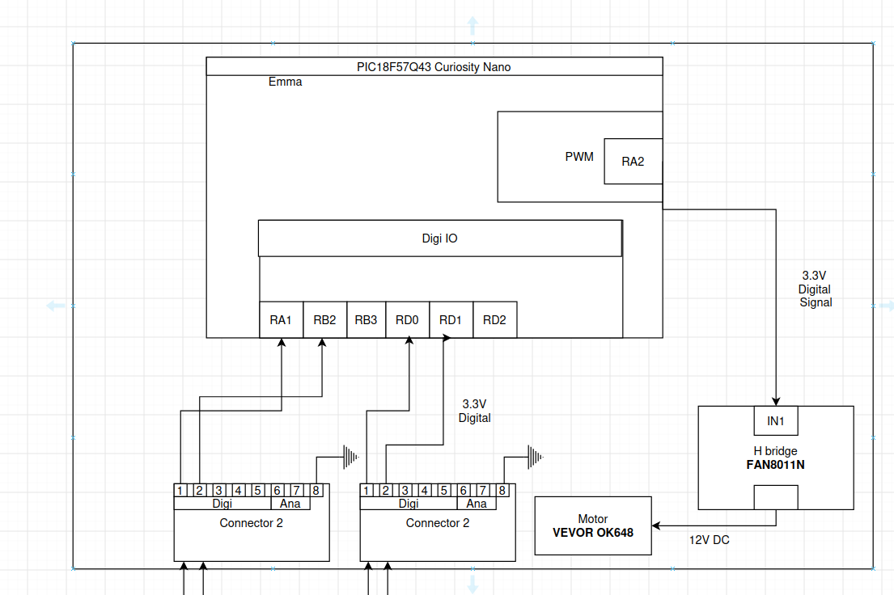

## Overview
This block diagram shows how my individual subsystem, the actuator control board, fits into the team project. It shows how power, control signals, and team connections flow between the microcontroller, the motor driver, and the actuator.

* **Microcontroller:** A PIC18F57Q43 Curiosity Nano controls the subsystem. It generates a PWM signal on pin RA2 to drive the motor, and uses digital I/O pins (RA1, RB2, RD0, RD1) to communicate with the rest of the team.
* **Actuator:** A VEVOR OK648 12 V linear actuator provides the system's mechanical motion.
* **Motor driver:** A FAN8011N H-bridge receives the 3.3 V PWM signal from the microcontroller on IN1. It switches 12 V DC to the actuator, letting the low-power microcontroller control the high-power motor.
* **Power levels:**
  * **12 V DC:** powers the actuator through the H-bridge
  * **3.3 V:** used for all logic-level signals between the microcontroller, the H-bridge, and the team connectors
* **Power source:** An external 12 V DC supply powers the board. It feeds the actuator directly through the H-bridge and is regulated down for the logic circuitry.
* **Sensor:** This subsystem has no sensor of its own. It acts on commands and data that come from teammates' boards through the team connectors.
* **Team connections:** Two 8-pin connectors link this board to the rest of the team's system. On each one, pins 1–2 carry 3.3 V digital signals to the microcontroller (RA1/RB2 on the first, RD0/RD1 on the second), and pin 8 provides a shared ground.

## Block Diagram

