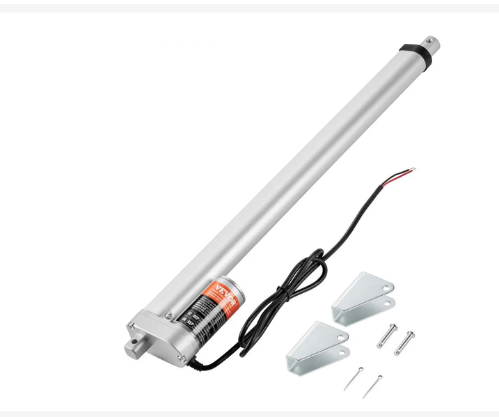
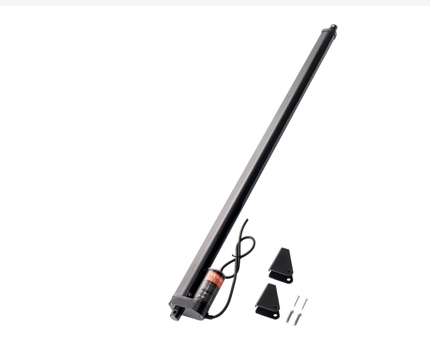

## Examples

### Style 1

> This is the example found in the assignment, uses more html

*Table 1: Example component selection*

**External Clock Module**

| **Solution**                                                                                                                                                                                      | **Pros**                                                                                                                                    | **Cons**                                                                                            |
| ------------------------------------------------------------------------------------------------------------------------------------------------------------------------------------------------- | ------------------------------------------------------------------------------------------------------------------------------------------- | --------------------------------------------------------------------------------------------------- |

|  Option 1. VEVOR 12V Linear Actuator, 18 in stroke (OK648-1500N) $42.90/each [link to product](https://www.vevor.com/linear-actuators-c_11633/vevor-linear-actuator-12v-18-inch-high-load-330lbs-1500n-linear-actuator-0-19-s-linear-motion-actuator-with-mounting-bracket-and-ip54-protection-p_010211529221) | \* Runs on 12 V DC, which matches the board's supply \* High load capacity (330 lbs / 1500 N) \* Mounting brackets included \* IP54 dust and splash protection | \* Draws up to 5 A, so the H-bridge must handle that current \* No built-in position feedback \* Only a 25% duty cycle \* Slow (0.19 in/s) and physically large |
|  Option 2. VEVOR 12V High-Speed Linear Actuator, 20 in stroke (OK648-1000N) $43.90/each [link to product](https://www.vevor.com/linear-actuators-c_11633/vevor-linear-actuator-12v-20inch-0-55-s-high-speed-220lbs-1000n-ip54-protection-p_010779702477) | \* Runs on 12 V DC, which matches the board's supply \* Fast travel speed (0.55 in/s) \* Quiet (≤50 dB) \* Built-in limit switches stop the motor at the ends of travel \* IP54 dust and splash protection | \* Lower load capacity than Option 1 (220 lbs / 1000 N) \* No built-in position feedback \* Current draw not listed, so H-bridge sizing is uncertain \* Long (24.6 in retracted body) |
                                             |

**Choice:** Option 1: VEVOR 12V Linear Actuator, 18 in stroke (OK648-1500N)

**Rationale:** This actuator runs directly on the board's 12 V supply and gives a higher load capacity (330 lbs / 1500 N) than Option 2. Its slower travel speed (0.19 in/s) makes position control from the microcontroller easier and more precise. VEVOR also lists its current draw (5 A), so we can confirm the H-bridge can handle it before ordering, while Option 2 gives no current rating. Although it is slower and lacks position feedback, its specifications are fully documented, which makes it the more predictable choice for our motor control board.

