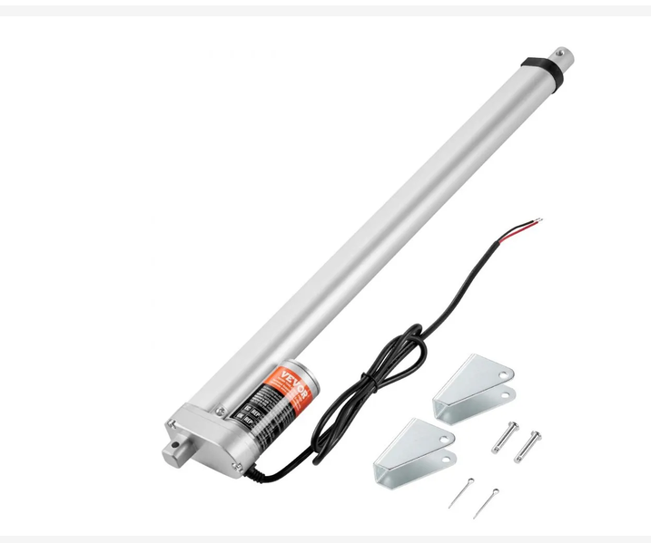
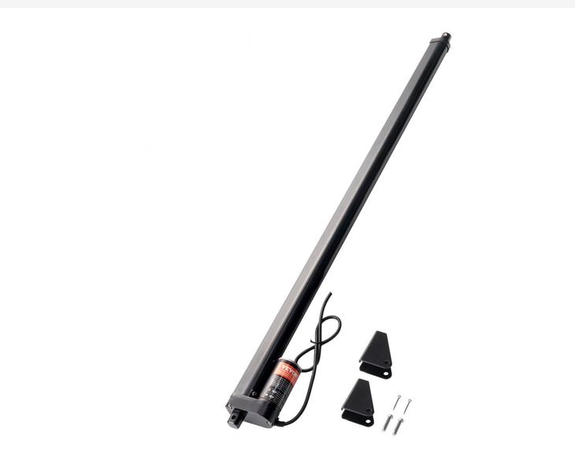
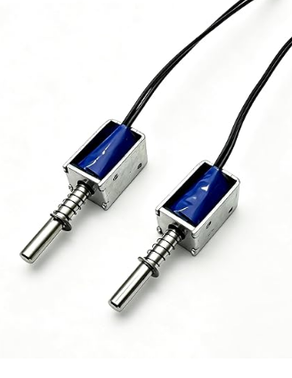
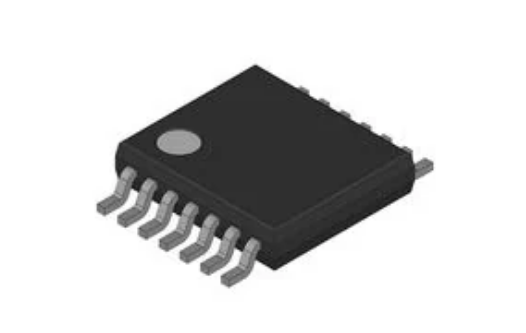

## Overview

The motor control board only needs two main components: a **motor driver (H-bridge)** and an **actuator**. The microcontroller sends forward/reverse logic signals to the H-bridge. The H-bridge switches power from the supply to the actuator and controls which direction it moves. Apart from these two parts, the board only needs basic support components such as decoupling capacitors, a power input, and connectors.

Because the two parts have to work together electrically, choosing one limits the options for the other. We chose the **FAN8100N** dual H-bridge first because our professor recommended it, it accepts 3.3 V and 5 V logic directly from the microcontroller, and its through-hole DIP package is easy to put on a PCB. However, the FAN8100N is a low-voltage driver. Its motor supply is rated for 1.8–9 V, and each channel can supply up to 1.5 A peak.

These limits ruled out most of the actuators we looked at. Typical linear actuators, including the two VEVOR models we compared, run on 12 V, and Option 1 draws up to 5 A. Both are above the FAN8100N's ratings. The **mini push-pull solenoid** was the only option that fit. It runs on 5–12 V, draws only 0.58 A at 9 V (the manufacturer's recommended "best balance" setting), and connects with two wires. Its tradeoffs are a short 5 mm stroke, a low 40 g pull force, and on-times kept to about 1 second. Even so, it is the only actuator we found that works within the driver's voltage and current limits.

### Actuation

| Option | Pros | Cons |
| --- | --- | --- |
|  Option 1. VEVOR 12V Linear Actuator, 18 in stroke (OK648-1500N) $42.90/each [link to product](https://www.vevor.com/linear-actuators-c_11633/vevor-linear-actuator-12v-18-inch-high-load-330lbs-1500n-linear-actuator-0-19-s-linear-motion-actuator-with-mounting-bracket-and-ip54-protection-p_010211529221) | \* High load capacity (330 lbs / 1500 N) \* Current draw is documented (5 A) \* Mounting brackets included \* IP54 dust and splash protection | \* Requires 12 V, above the FAN8100N's 9 V limit \* Draws up to 5 A, above the FAN8100N's 1.5 A rating \* No built-in position feedback \* Only a 25% duty cycle \* Slow (0.19 in/s) and physically large |
|  Option 2. VEVOR 12V High-Speed Linear Actuator, 20 in stroke (OK648-1000N) $43.90/each [link to product](https://www.vevor.com/linear-actuators-c_11633/vevor-linear-actuator-12v-20inch-0-55-s-high-speed-220lbs-1000n-ip54-protection-p_010779702477) | \* Fast travel speed (0.55 in/s) \* Quiet (≤50 dB) \* Built-in limit switches stop the motor at the ends of travel \* IP54 dust and splash protection | \* Requires 12 V, above the FAN8100N's 9 V limit \* Current draw not listed, so H-bridge sizing is uncertain \* Lower load capacity than Option 1 (220 lbs / 1000 N) \* No built-in position feedback \* Long (24.6 in retracted body) |
|  Option 3. Mini DC Push-Pull Solenoid, 5 mm (0.2 in) stroke $[$15.96/each]/each [link to product](https://a.co/d/00NUZCQU) | \* Runs on 5–12 V DC, so it works on the board's 9 V supply \* Low current draw (0.40 A at 6 V, 0.58 A at 9 V, 0.77 A at 12 V) \* Small and light (12 x 11 x 38.2 mm, 13.5 g) \* Simple 2-wire connection (90 mm cable) | \* Very short stroke (5 mm) \* Low pull force (40 g max) \* Short-term use only: max ~1 s continuous on-time to avoid overheating \* Runs hotter at higher voltages |

**Choice:** Option 3: Mini DC Push-Pull Solenoid, 5 mm (0.2 in) stroke

**Rationale:** Option 1 was our first choice because of its high load capacity (330 lbs / 1500 N) and fully documented specifications, but it needs 12 V and up to 5 A, which is more than our motor driver can supply. Option 2 has the same 12 V problem and does not list its current draw. The solenoid was the only option that works within the H-bridge's limits. It runs on the board's 9 V supply, so the H-bridge can drive it directly without a separate power stage or converter. At 9 V it draws 0.58 A, which is within the FAN8100N's 1.5 A per-channel rating. Its 40 g pull force and 5 mm stroke are enough for a demonstration model. It would not be strong enough for a full-scale work bench, but it is the only choice compatible with our motor control board, which makes it the right fit for this design.

### Control

| Option | Pros | Cons |
| --- | --- | --- |
|  Option 1. Fairchild/onsemi FAN8100N Low-Voltage 2-Channel DC Motor Driver (12-DIP) $[price]/each [link to product](https://www.digikey.com/en/products/detail/rochester-electronics-llc/FAN8100N/11558200) | \* Two full H-bridge channels in one chip, so it can drive a brushed DC motor forward, reverse, and brake \* Works directly with 3.3 V and 5 V microcontroller logic \* Simple parallel control interface (forward/reverse inputs per channel) \* Through-hole DIP package, which is easy to solder and prototype on a PCB \* Recommended by our professor | \* Motor supply rated 1.8–9 V (10.5 V absolute max), which rules out 12 V actuators \* Peak output current is only 1.5 A per channel \* Marked obsolete; sold through Rochester Electronics on DigiKey Marketplace \* Bipolar transistors, so it has more voltage drop and heat than a MOSFET driver |

**Choice:** Option 1: Fairchild/onsemi FAN8100N 2-Channel DC Motor Driver

**Rationale:** The FAN8100N puts two full H-bridge channels in a single through-hole IC, so the board can drive the actuator forward, in reverse, and brake it without discrete transistors. Its inputs accept 3.3 V and 5 V logic, so it connects directly to the microcontroller's GPIO pins. The DIP package is easy to place and solder on our PCB. Our professor also recommended this driver to another student for a similar design, which gives us confidence it is suitable for a class motor control board. Its main limits are a 9 V maximum operating supply and a 1.5 A peak output per channel, so the actuator's voltage and current draw must stay within those ratings.