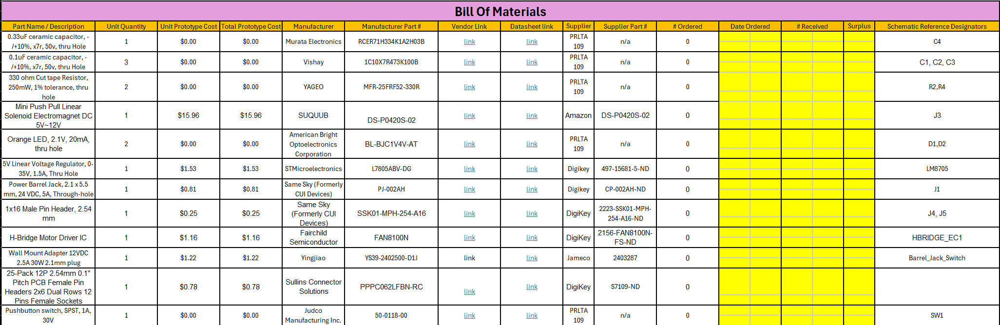

## Overview
This Bill of Materials documents Project SBWB’s (Self-Balancing Work Bench) actuation and motor control board. It lists every part needed for one prototype unit, along with its manufacturer, supplier and datasheet. The board takes 12 VDC from a wall adapter through a barrel jack, regulates it down to 5 V for the logic, and uses an on-board H-bridge motor driver IC to drive the linear actuator under control of the microcontroller. Status LEDs and a pushbutton are included for indication and manual input. This serves as documentation of the parts that make up the subsystem, so it can be referred to and replicated.

Some important notes: Unit Quantity is how many of each component are in one module. Unit Prototype Cost is the cost of one of that component, and Total Prototype Cost is what it costs to buy enough of that part for one complete prototype. Parts listed as $0.00 come from the PRLTA 109 lab stock. # Ordered counts extra parts bought for breadboarding and replacements, not the number the board needs. The Date Ordered, # Received and Surplus columns track orders as they come in.

## Bill of Materials Example (as Image)
{style width: "2000"}
**Figure 2:** Emma Bill of Materials

As you can see, the text can be difficult to read without opening the image.

## Resources

The BOM as a PDF download is available [here](emmabom.pdf), and a Microsoft Excel Sheet [here](EMMAC_EGR304_BOM.xlsx).
