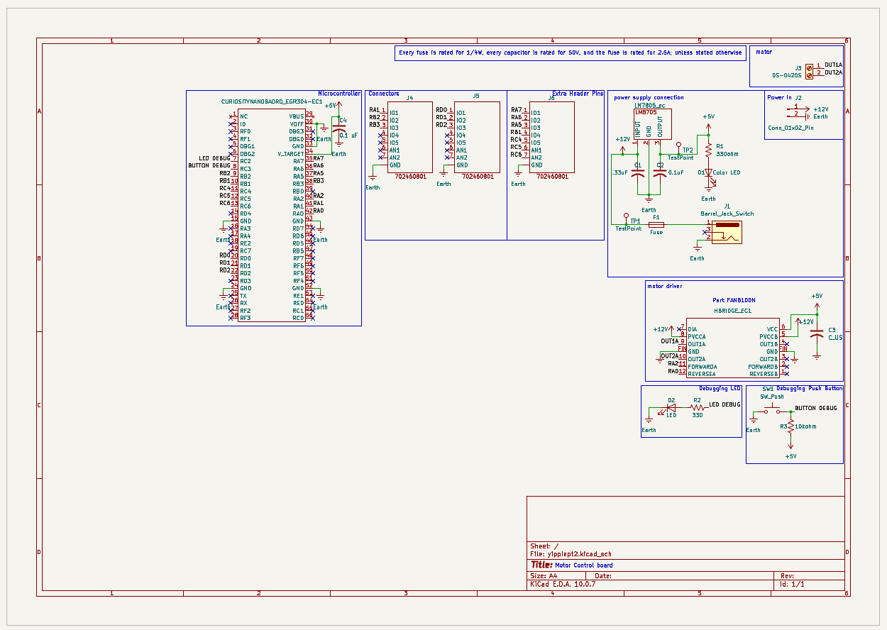

## Overview

This schematic shows the actuation and motor control board for Project SBWB (Self-Balancing Work Bench). The board's job is to move the actuator when the microcontroller tells it to. Power comes in at 12 V DC through a barrel jack or a 2-pin header, passes through a fuse, and is regulated down to 5 V by an LM7805 to power the logic. The Curiosity Nano microcontroller sends forward and reverse signals to a FAN8100N H-bridge motor driver, which switches power to the actuator through the motor connector. Three headers carry the microcontroller's I/O pins off the board so other subsystems, such as the distance-sensing board, can connect. A power indicator LED, two test points, a debug LED, and a debug push button make the board easier to test and troubleshoot. This schematic documents how the subsystem is wired, so it can be referred to, built, and replicated.

{style width:"350" height:"300;"}
**Figure ##:** Showing Emma's Schematic

## Schematic Description

This schematic shows the actuation and motor control board for Project SBWB. The board takes 12 V DC in, regulates it to 5 V for the logic, and uses a FAN8100N H-bridge driver to drive the actuator under control of the microcontroller. It is split into the following blocks.

**Microcontroller:** The Curiosity Nano (EGR304 board) is the main controller. Its 5 V and ground pins connect to the board's supply rails, and C4 (0.1 µF) decouples its supply. Its I/O pins are labeled with net names (RA, RB, RC, RD) that go to the connectors, the motor driver, and the debug circuits.

**Connectors (J4, J5, J6):** Three 702460801 headers bring the microcontroller's I/O pins off the board so other subsystems, such as the team's distance-sensing board, can connect. Each header carries digital I/O lines and a ground. J6 is an extra header for added signals.

**Power Supply:** 12 V comes in through either the barrel jack (J1) or the 2-pin power header (J2). F1 (2.5 A) protects the board from overcurrent. An LM7805 linear regulator steps 12 V down to 5 V for the logic. C1 (0.33 µF) on its input and C2 (0.1 µF) on its output keep it stable. D1, with current-limiting resistor R1 (330 Ω), is a power indicator LED that lights when 5 V is present. Test points TP1 (12 V input) and TP2 (5 V output) allow quick voltage checks with a multimeter.

**Motor Driver:** The FAN8100N H-bridge drives the actuator. Its logic supply (VCC) runs from 5 V, and its motor supplies (PVCCA, PVCCB) come from the motor supply rail. C3 decouples the supply. The microcontroller controls direction through FORWARDA (RA2) and REVERSEA (RA0): one input drives the actuator forward, the other reverses it, and both together brake it. Channel A's outputs (OUT1A, OUT2A) go to the motor connector J3. Channel B is unused.

**Motor Connector (J3):** A 2-pin connector carries OUT1A and OUT2A to the actuator.

**Debugging LED:** D2, with current-limiting resistor R2 (330 Ω), is driven by the LED DEBUG pin on the microcontroller. It lets the code show status visually during testing.

**Debugging Push Button:** SW1 connects the BUTTON DEBUG pin to ground when pressed. R3 (10 kΩ) pulls the pin up to 5 V, so the pin reads high normally and low when the button is pressed. This gives a manual input for testing the code.

**Design Note:** Unless stated otherwise, every resistor is rated for 1/4 W, every capacitor is rated for 50 V, and the fuse is rated for 2.5 A.
**Connector

## Resouces

The schematic as a PDF download is available [*here*](ExampleSchematic.pdf), and the Zip folder of the project [*here*](dummyZip.zip).