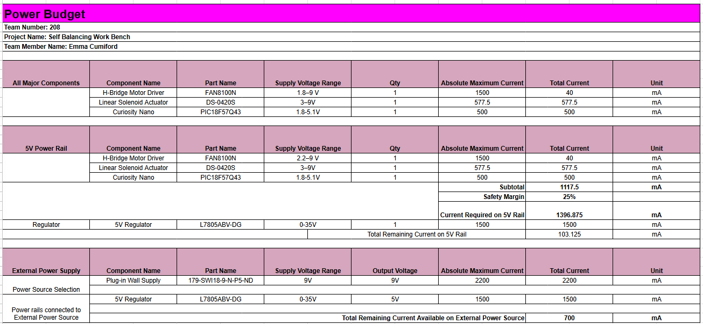

## Overview

A power budget lists every major component on the board, how much current each one can draw, and which power rail supplies it. The goal is to confirm that the voltage regulator and the external power supply can deliver enough current for everything on the board, with room to spare. Without this check, the board could brown out, reset, or overheat when the actuator turns on.

For the Project SBWB motor control board, I listed the three major components: the FAN8100N H-bridge motor driver, the DS-0420S solenoid actuator, and the Curiosity Nano microcontroller. I recorded each one's supply voltage range and maximum current draw, then added them up on the 5 V rail and applied a 25% safety margin. I then picked a 5 V regulator (L7805ABV-DG) and a plug-in wall supply (SWI18-9-N-P5) that can handle that load.

{ style="width:100%;" }

**Figure 1:** Power budget for the Project SBWB motor control board

## Conclusions

The power budget shows that the selected parts can power the board. The components on the 5 V rail draw a subtotal of 1117.5 mA. With a 25% safety margin, the 5 V rail requires 1396.875 mA. The L7805ABV-DG regulator can supply up to 1500 mA, which leaves 103.125 mA of extra current on the 5 V rail.

The 9 V, 2200 mA plug-in wall supply powers the regulator. Even if the regulator draws its full 1500 mA, the wall supply still has 700 mA available. The original 650 mA wall supply was not enough to power the board, which is why it was replaced with the 2.2 A supply. The budget is conservative because it uses each part's absolute maximum current, so the real current draw during normal operation will be lower.

## Resources

The power budget as a PDF download is available [*here*](PowerBudget_EGR330.pdf), and a Microsoft Excel Sheet [*here*](PowerBudget_EGR330.xlsx).